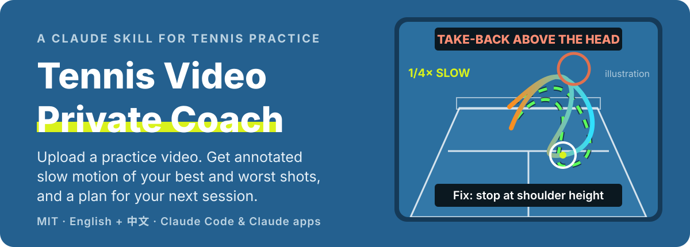
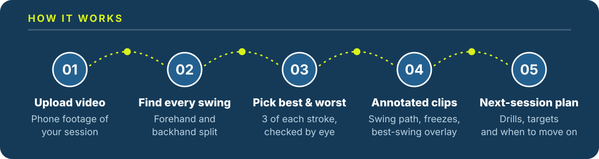

<p align="center">
  
</p>

<p align="center">
  <b>English</b> · <a href="README.zh-CN.md">中文</a> · <a href="https://zakezhang.github.io/tennis-video-review-public/">Project page</a>
</p>

<p align="center">
  
  
  
</p>

**Tennis Video Private Coach** is an open-source AI skill for amateur players. Give your AI agent a phone video of your practice and get back what a coach would tell you after watching it: which part of your stroke breaks down, the shots that prove it, and what to practice next.

## Quick start

### 1. Copy this line. Send it to your AI.

Paste into the **chat box** of the AI tool or agent you use:

```text
Install and set up this tennis video review skill, and check its requirements: https://github.com/zakezhang/tennis-video-review-public/tree/main/skills/tennis-video-private-coach
```

You can send the same prompt to **Codex, ChatGPT, Claude, DeepSeek, Gemini, Kimi, Workbuddy, or Trae**. Agents with skill support can configure it for their environment. If installation is unavailable, ask the AI to read the skill’s `SKILL.md` and follow it in this chat.

### 2. Upload your video. Tell it about you.

Upload a practice video, or give a local agent its file path, then send:

> Review this video using the tennis video coach skill. **I'm the one in the white shirt, right-handed, two-handed backhand.** My forehands go into the net when the ball comes fast. Tell me what to practice this week.

Which player you are, your dominant hand and backhand, and the one problem you want fixed. Add last time's report for a before/after comparison.

**Requirements:** the full review needs video file access and code execution; a text-only chat cannot produce annotated clips. Loading instructions for this chat does not install a persistent skill.

<details>
<summary><b>Manual setup / AI cannot open GitHub?</b></summary>

- Download this repository using **Code → Download ZIP**, then extract it.
- **Codex:** ask its built-in `$skill-installer` to install `skills/tennis-video-private-coach` from this repository. Alternatively, copy that entire skill folder into your project's `.agents/skills/` directory. If the skill does not appear, restart Codex. See the [official skills guide](https://learn.chatgpt.com/docs/build-skills).
- **Claude Code:** copy the entire skill folder into `~/.claude/skills/` (create the directory if needed). See the [official skills guide](https://code.claude.com/docs/en/skills).
- **Apps with custom skill upload:** zip the skill folder, upload it through the app's supported skill interface, and enable code execution if available.
- **Other chats:** upload `SKILL.md` from the skill folder and ask the AI to follow it in this conversation. File upload and code execution depend on the tool and account.

Choose **one** version: `skills/tennis-video-private-coach/` for English, or `skills/tennis-video-private-coach-zh/` for Chinese. The workflow uses `ultralytics`, `opencv-python`, `numpy`, `scipy`, and `Pillow`, plus Python 3 and ffmpeg. No GPU required. Package installation and the first model download need network access.

</details>

## What you get

- **12 annotated clips**: your 3 best and 3 worst forehands and backhands, at quarter speed on your own footage, with your swing path drawn on you, freezes at the take-back and at contact, and your best swing overlaid on your worst.
- **A straight answer to your question**, such as *"why do my forehands fly long?"*, at the top of the report.
- **Technique measured on every swing**: take-back height, knee bend, stance width, contact height.
- **Knees and footwork, every time**: hopping, one-leg landings, pivoting on a straight leg.
- **Net and out counts** when the ball is visible, and a plain note when it isn't.
- **A plan for your next session** that fits how you train: wall, ball machine, coach or partner.

<p align="center">
  
</p>

## Faults it checks first

| You notice | It usually finds |
| --- | --- |
| Balls fly long or into the sky | A swing path that finishes straight up; lifting from the knees on high bounces |
| Forehands into the net | A take-back above the head, so the racket can't drop in time |
| Contact too far back, then crowded | Late preparation: reaching for wide balls, flicking fast ones |
| Two-handed backhand into the net | The racket held upright at the chest instead of resting at the hip |
| Hopping, landing on one leg | A narrow stance and swinging before the feet stop |
| Late one-handed backhand | Setting up as a two-hander, then switching |

Each comes with how it shows on video and a drill to fix it.

## Film it so the review is sharp

- **Side-on is the most useful angle**: outside the net on your hitting side, 3–4 m away, at waist height.
- **Behind you**, 1.2–1.5 m high and centered, is best for counting net and out.
- 4K 60 fps or 1080p 120 fps, focus and exposure locked, a few continuous minutes.
- Outdoors, frame more of the far court and less sky and trees.

## Limits

- Pose comes from one phone camera, so angles are estimates. Compare with your own past sessions, not with other players.
- With moving trees or many people in the background the ball usually can't be tracked, so no net/out percentage is given.
- Not medical advice. If something keeps hurting, see a sports-medicine doctor.

<details>
<summary><b>What's in this repository</b></summary>

```
skills/
  tennis-video-private-coach/      English skill
  tennis-video-private-coach-zh/   Chinese skill
docs/index.html                    Project page (GitHub Pages)
assets/readme/                     README images (SVG)
```

</details>

## License

MIT. See [LICENSE](LICENSE).
