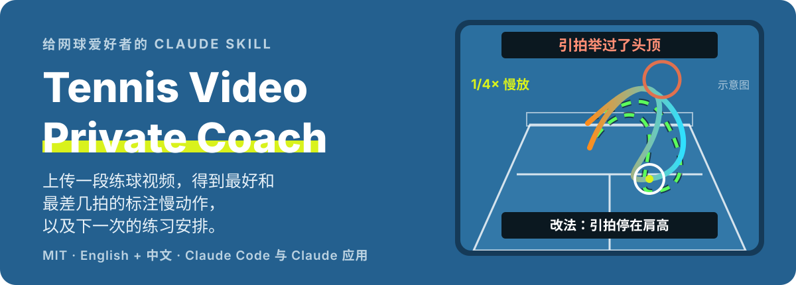
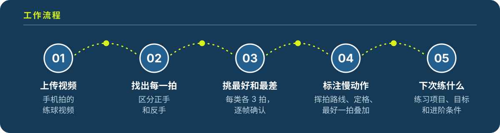

<p align="center">
  
</p>

<p align="center">
  <a href="README.md">English</a> · <b>中文</b> · <a href="https://zakezhang.github.io/tennis-video-review-public/?lang=zh">介绍页</a>
</p>

<p align="center">
  
  
  
</p>

**Tennis Video Private Coach** 是一个给业余网球爱好者的开源 AI 技能。把手机拍的练球视频交给你的 AI Agent，它会像看过录像的教练一样告诉你：动作哪个环节出了问题、证据是哪几拍、下次具体练什么。

## 快速开始

### 1. 复制这一句，发给你的 AI

把下面这句话粘贴到你常用的 AI 工具或 Agent 的**聊天输入框**，发送即可：

```text
请帮我安装并配置这个网球视频复盘 Skill，检查运行环境：https://github.com/zakezhang/tennis-video-review-public/tree/main/skills/tennis-video-private-coach-zh
```

**Codex、ChatGPT、Claude、DeepSeek、Gemini、Kimi、Workbuddy、Trae** 都可以使用这个入口。支持技能安装的 Agent 会按当前工具的方式配置；不支持安装时，请让 AI 读取技能中的 `SKILL.md`，在本次对话中按它执行。

### 2. 上传视频，说清你的情况

上传练球视频，或把文件路径发给本地 Agent，再发送：

> 用网球视频私教技能帮我复盘这个视频。**穿白衣服的是我，右手持拍，双手反手。**球一快我的正手就下网。告诉我这周该练什么。

说清哪个人是你、持拍手和反手方式、最想解决的一个问题。带上上次的报告，还能看到前后对比。

**运行条件：**完整复盘需要读取视频和执行代码；纯聊天环境无法生成标注慢动作。在本次对话中加载流程，不等于永久安装技能。

<details>
<summary><b>手动安装 / AI 打不开 GitHub？</b></summary>

- 点击仓库的 **Code → Download ZIP**，下载并解压。
- **Codex：**让内置的 `$skill-installer` 从本仓库安装 `skills/tennis-video-private-coach-zh`。也可以把整个技能文件夹复制到项目的 `.agents/skills/` 目录。如果技能没有出现，重启 Codex。参见 [官方技能说明](https://learn.chatgpt.com/docs/build-skills)。
- **Claude Code：**把整个技能文件夹复制到 `~/.claude/skills/`（目录不存在则先创建）。参见 [官方技能说明](https://code.claude.com/docs/en/skills)。
- **支持上传自定义技能的应用：**将技能文件夹打成 zip，通过应用支持的技能入口上传，并在可用时开启代码执行。
- **其他聊天工具：**上传技能文件夹里的 `SKILL.md`，让 AI 在本次对话中按它执行。文件上传和代码执行能力取决于工具及账号。

两个语言版本**选一个**即可：中文 `skills/tennis-video-private-coach-zh/`，英文 `skills/tennis-video-private-coach/`。运行需要 Python 3、ffmpeg，以及 `ultralytics`、`opencv-python`、`numpy`、`scipy`、`Pillow`，不需要 GPU。安装依赖和首次下载模型需要联网。

</details>

## 你会得到

- **12 段标注视频**：正手、反手各挑最好和最差 3 拍，在你自己的画面上 1/4 慢放，画出挥拍路线，在引拍最高点和击球瞬间定格，并把你最好的一拍叠到最差的一拍上。
- **直接回答你的问题**，比如“为什么正手总飞天”，放在报告最前面。
- **每一拍都测动作**：引拍高度、屈膝、站距、击球高度。
- **每次都看膝盖和脚步**：跳着打、单脚落地、直腿钉住转身。
- **过网 / 下网统计**：看得清球时统计；看不清时直接说明。
- **下一次的练习安排**：按你用练习墙、发球机、教练还是对拉来写。

<p align="center">
  
</p>

## 它会先排查这些问题

| 你遇到的 | 通常的原因 |
| --- | --- |
| 球飞天、出底线 | 收拍直冲头顶；高球站在原地从膝盖往上拉 |
| 正手下网 | 引拍举过头，落拍来不及 |
| 击球点忽前忽后 | 准备晚：宽球伸手去够，急球在侧面甩 |
| 双反下网 | 拍子竖着举在胸前，而不是平放在腰侧 |
| 跳着打、单脚落地 | 站得太窄，脚没停住就挥拍 |
| 单反引拍晚 | 先摆成双反，再临时改单反 |

每一条都会说明在视频里怎么认，以及用什么练习来改。

## 这样拍，复盘更准

- **侧面机位最有用**：持拍手一侧网外 3–4 米、腰高。
- **身后机位** 1.2–1.5 米高、正对中线，最适合统计过网 / 下网。
- 4K 60 帧或 1080p 120 帧，锁定对焦和曝光，连续拍几分钟。
- 室外少拍天空和树，多拍对面场地。

## 局限

- 姿态来自单个手机机位，角度只是估计，适合和自己的历次数据比，不适合和别人比。
- 背景有晃动的树或很多人时，通常追踪不到球，不会给出过网 / 下网比例。
- 不是医疗建议。持续疼痛请去看运动医学科。

<details>
<summary><b>仓库里有什么</b></summary>

```
skills/
  tennis-video-private-coach/      英文版
  tennis-video-private-coach-zh/   中文版
docs/index.html                    介绍页（GitHub Pages）
assets/readme/                     README 图片（SVG）
```

</details>

## 许可证

MIT，见 [LICENSE](LICENSE)。
